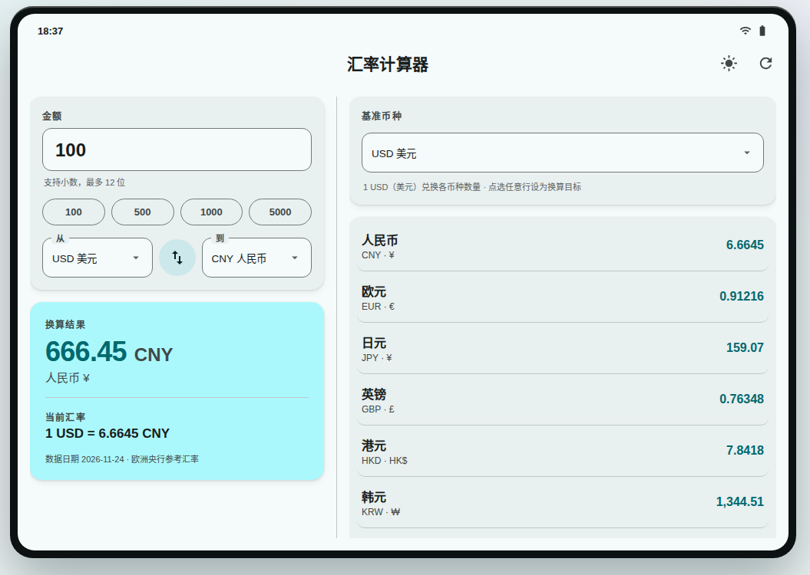
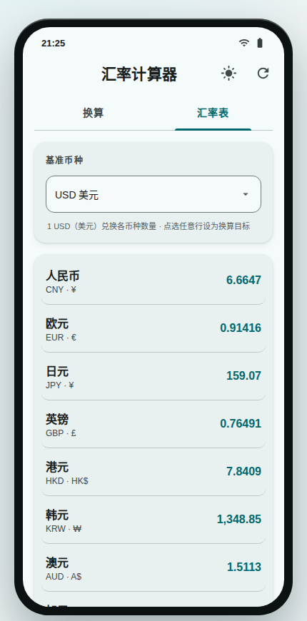
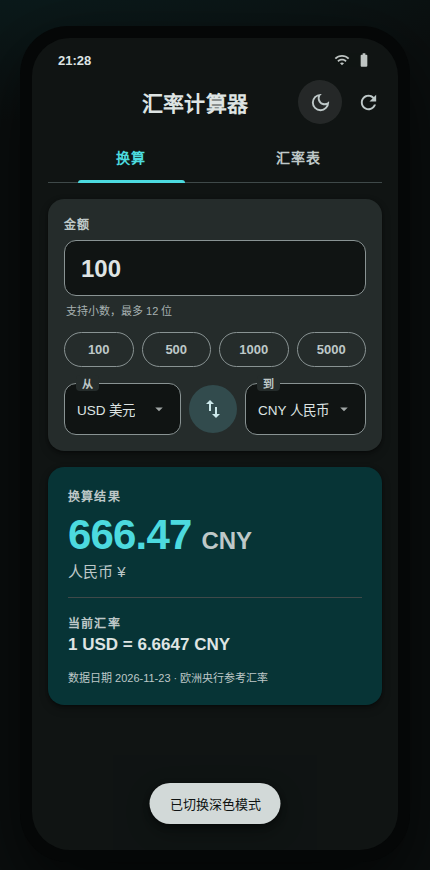

# 汇率计算器（Currency Calculator）

[](https://github.com/huangyss/currency-calculator/releases)
[](LICENSE)
[](https://developer.android.com/about/versions)
[](https://kotlinlang.org/)
[](https://github.com/huangyss/currency-calculator/actions/workflows/android.yml)

使用 **Kotlin + Jetpack Compose + Material Design 3** 开发的 Android 汇率换算应用，
针对 **手机 / 平板 / 折叠屏** 做了完整的自适应布局。

## 📲 下载安装

直接下载最新安装包，手机上打开即可安装（Android 9+）：

**➡️ [前往 Releases 页面下载 APK](https://github.com/huangyss/currency-calculator/releases/latest)**（当前最新：v1.2.0）

## ✨ 界览

| 手机 · 换算页 | 平板 · 双栏自适应 |
|:---:|:---:|
|  |  |

| 汇率表 | 深色模式 |
|:---:|:---:|
|  |  |

> 仓库内 [`preview.html`](preview.html) 是可交互的 Material 3 网页预览，浏览器直接打开即可体验换算逻辑与两种布局。

## 功能特性

| 功能 | 说明 |
|------|------|
| 实时汇率换算 | 数据来自欧洲央行（ECB）每日参考汇率，经 Frankfurter 开放 API 获取，免密钥 |
| 30 种常用货币 | 美元、人民币、欧元、日元、英镑、港元、韩元等，含中文名称与符号 |
| 一键互换币种 | 点击中间 ⇅ 按钮互换源/目标币种 |
| 汇率一览表 | 以任意基准币种查看全部货币汇率，点选即设为换算目标 |
| 离线缓存 | 缓存以**欧洲央行发布时刻**为界判定新旧，网络失败时回退最近一次汇率并明确标注「离线缓存」 |
| 刷新反馈 | 已有数据时后台刷新，顶部显示进度指示，不清空当前内容（不闪屏） |
| Material Design 3 | 支持 Material You 动态取色（Android 12+）、深色模式、大字号 |
| 快捷金额 | 100 / 500 / 1000 / 5000 一键填入 |
| **平板自适应布局** | 按窗口宽度三档自动切换（见下节） |

## 自适应布局（平板 / 折叠屏 / 分屏）

| 窗口宽度 | 场景 | 布局 |
|----------|------|------|
| < 600dp（compact） | 手机竖屏 | 顶部 Tab + 单栏 |
| 600–840dp（medium） | 手机横屏 / 平板竖屏 | 侧边 NavigationRail + 单栏（内容居中限宽 640dp） |
| ≥ 840dp（expanded） | 平板横屏 / 折叠屏展开 | **双栏并排**：左「换算」+ 右「汇率表」，各自独立滚动 |

- 以**窗口宽度**（而非屏幕宽度）判定，分屏、悬浮窗场景同样正确
- 满足 Android 17（targetSdk 37）对大屏设备强制自适应的要求（不再锁定屏幕方向/尺寸）

## 技术栈

- 语言：Kotlin 2.4.21（AGP 9 内置 Kotlin + Compose 编译器插件）
- UI：Jetpack Compose + Material 3（compose-bom 2026.11.01）
- 架构：ViewModel + StateFlow 单向数据流
- 网络：OkHttp 4.12（`api.frankfurter.dev` 与旧域名 `.app`，后者 301 跳转至前者，属同一服务而非双数据源）
- 构建：Gradle 9.6 / Android Gradle Plugin 9.5.2 / JDK 17+
- 最低支持：**Android 9（API 28）**，目标 **Android 17（API 37）**

## 项目结构

```
app/src/main/java/com/exchangerate/calculator/
├── MainActivity.kt              # 入口 + 三档自适应布局（Tab / NavRail / 双栏）
├── MainViewModel.kt             # 换算输入与汇率加载状态（刷新去重、来源标记）
├── data/
│   ├── Currency.kt              # 币种目录（代码/中文名/符号）
│   ├── RatesApi.kt              # Frankfurter API 封装 + JSON 解析
│   ├── RateFreshness.kt         # 缓存新鲜度：以 ECB 发布时刻为界，而非挂钟 TTL
│   └── RatesRepository.kt       # 网络 + SharedPreferences 缓存，返回数据来源
└── ui/
    ├── theme/                   # Material 3 主题（配色/字体）
    ├── components/CurrencyDropdown.kt
    ├── WindowWidthClass.kt      # 窗口宽度分级（compact/medium/expanded）
    ├── ConverterScreen.kt       # 换算页
    ├── RatesTableScreen.kt      # 汇率表页
    ├── AmountInput.kt           # 金额输入过滤（纯函数，可单测）
    └── FormatUtils.kt           # 数字格式化

app/src/test/java/...            # 单元测试（28 个用例）
```

## 构建方式

### Android Studio（推荐）

需要 **2026 年及以后的 Android Studio**（支持 AGP 9.5.2 / Gradle 9.6 / compileSdk 37.2）。
旧版本（如 Ladybug、Meerkat）会在 Sync 阶段失败，因为 AGP 9 已内置 Kotlin 且 `compileSdk` 提升了 minor 版本。

1. 直接打开仓库根目录（**根目录即项目根**，无需再进入子目录）
2. 等待 Gradle Sync 完成（需要 JDK 17+）
3. 连接手机/平板或启动模拟器，点击 Run ▶

### 命令行

```bash
# 在仓库根目录执行；确认 local.properties 中 sdk.dir 指向本机 Android SDK
./gradlew assembleDebug        # 产物：app/build/outputs/apk/debug/app-debug.apk
./gradlew testDebugUnitTest    # 运行单元测试
```

## UI 预览

仓库根目录下的 [`preview.html`](preview.html) 是可交互的 Material 3 网页预览，
可在浏览器中体验手机 / 平板双栏两种布局与换算逻辑（直接双击打开即可，无需服务器）。

## 数据来源

汇率数据：[Frankfurter API](https://www.frankfurter.app/)（欧洲央行每个工作日约 16:00 CET 发布参考汇率）。
本应用仅供学习与日常换算参考，不构成任何交易依据。

## 单元测试

```bash
./gradlew testDebugUnitTest
# 报告：app/build/reports/tests/testDebugUnitTest/index.html
```

全部是纯 JVM 测试（不依赖设备或模拟器），5 个测试类共 28 个用例：

| 测试类 | 覆盖点 |
|--------|--------|
| `RateFreshnessTest` | 缓存新鲜度：16:00 发布边界、周末回退、整点即视为已发布 |
| `RateSnapshotTest` | 交叉汇率推导、缺失币种、汇率为 0 时返回 `null` 而非无穷大 |
| `RatesApiParseTest` | 正常响应、缺省 `base`、缺 `rates` 与非法 JSON |
| `FormatUtilsTest` | 千分位、零小数币种（JPY/KRW）、非有限值降级为「—」 |
| `AmountInputTest` | 字符过滤、仅保留一个小数点、前导零规范化、长度上限 |

## 持续集成

`main` 分支每次推送 / PR 都会触发 [GitHub Actions](https://github.com/huangyss/currency-calculator/actions/workflows/android.yml)：
自动安装 Android 37.2 SDK → `./gradlew testDebugUnitTest` → `./gradlew assembleDebug` → 上传 APK 构建产物。
测试不通过则构建失败。

## 参与贡献

欢迎提交 [Issue](https://github.com/huangyss/currency-calculator/issues) 反馈问题或建议：

1. Fork 本仓库并创建分支：`git checkout -b feature/your-feature`
2. 提交改动：`git commit -m "feat: xxx"`
3. 推送并发起 Pull Request

## 开源协议

本项目基于 [MIT License](LICENSE) 开源，© 2026 Horizon (huangyss)。

## 版本记录

见 [CHANGELOG.md](CHANGELOG.md)。
