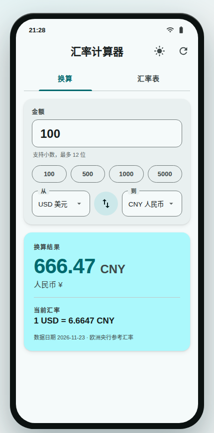

# 汇率计算器

**Kotlin + Jetpack Compose + Material Design 3** 编写的 Android 汇率换算应用。数据取自欧洲央行每日参考汇率，界面为手机、平板、折叠屏做了三档自适应布局。

[](https://github.com/huangyss/currency-calculator/releases)
[](https://github.com/huangyss/currency-calculator/actions/workflows/android.yml)
[](LICENSE)
[](https://developer.android.com/about/versions)
[](https://kotlinlang.org/)

## 界面

| 手机 · 换算 | 平板 · 双栏 |
|:---:|:---:|
|  |  |

| 汇率表 | 深色模式 |
|:---:|:---:|
|  |  |

## 下载安装

在 [Releases 页面](https://github.com/huangyss/currency-calculator/releases/latest) 下载最新 APK（当前 v1.2.0），手机上打开即可安装，要求 **Android 9 及以上**。

> 安装包使用 Android 调试签名，仅供体验；正式分发请自行配置签名后构建。

## 功能

| 功能 | 说明 |
|------|------|
| 汇率换算 | 30 种常用货币，数据来自欧洲央行（ECB）每日参考汇率，经 Frankfurter 开放 API 获取，免密钥 |
| 一键互换 | 点击中间 ⇅ 互换源币种与目标币种 |
| 汇率一览 | 以任意币种为基准查看全部汇率，点选即设为换算目标 |
| 快捷金额 | 100 / 500 / 1000 / 5000 一键填入 |
| 离线可用 | 缓存汇率，断网时回退最近一次数据并明确标注「离线缓存」 |
| 刷新不闪屏 | 已有数据时后台刷新，顶部显示进度，不清空当前内容 |
| 大额不溢出 | 结果数字按可用宽度在 36sp–18sp 间自动缩放，始终单行完整显示 |
| Material Design 3 | 支持动态取色（Android 12+）、深色模式、大字号跟随系统 |

## 自适应布局

按**窗口宽度**而非屏幕宽度分级，因此分屏、悬浮窗、折叠屏展开都能正确响应。

| 窗口宽度 | 典型场景 | 布局 |
|----------|----------|------|
| < 600dp | 手机竖屏 | 顶部 Tab + 单栏 |
| 600–840dp | 手机横屏、平板竖屏 | 侧边 NavigationRail + 单栏，内容居中限宽 640dp |
| ≥ 840dp | 平板横屏、折叠屏展开 | 双栏并排：左「换算」右「汇率表」，各自独立滚动 |

这也满足 Android 17（targetSdk 37）对大屏设备的要求——不再锁定屏幕方向与尺寸。

## 技术栈

| 项目 | 选型 |
|------|------|
| 语言 | Kotlin 2.4.21（AGP 9 内置 Kotlin 与 Compose 编译器插件） |
| UI | Jetpack Compose + Material 3（compose-bom 2026.11.01） |
| 架构 | ViewModel + StateFlow，单向数据流 |
| 网络 | OkHttp 4.12 |
| 构建 | Gradle 9.6 / AGP 9.5.2 / JDK 17+ |
| 兼容 | minSdk 28（Android 9）、targetSdk 37（Android 17）、compileSdk 37.2 |

## 项目结构

```
app/src/main/java/com/exchangerate/calculator/
├── MainActivity.kt              # 入口 + 三档自适应布局（Tab / NavRail / 双栏）
├── MainViewModel.kt             # 换算输入与汇率加载状态（刷新去重、来源标记）
├── data/
│   ├── Currency.kt              # 币种目录（代码 / 中文名 / 符号 / 小数位）
│   ├── RatesApi.kt              # Frankfurter API 封装 + JSON 解析
│   ├── RateFreshness.kt         # 缓存新鲜度：以 ECB 发布时刻为界，而非挂钟 TTL
│   └── RatesRepository.kt       # 网络 + SharedPreferences 缓存，返回数据来源
└── ui/
    ├── theme/                   # Material 3 主题（配色 / 字体）
    ├── components/CurrencyDropdown.kt
    ├── WindowWidthClass.kt      # 窗口宽度分级（compact / medium / expanded）
    ├── ConverterScreen.kt       # 换算页
    ├── RatesTableScreen.kt      # 汇率表页
    ├── AmountInput.kt           # 金额输入过滤（纯函数，可单测）
    └── FormatUtils.kt           # 数字格式化

app/src/test/java/...            # 单元测试（5 个测试类，28 个用例）
```

## 构建

需要 **JDK 17+** 与 **2026 年及以后的 Android Studio**（支持 AGP 9.5.2 / Gradle 9.6 / compileSdk 37.2）。旧版本如 Ladybug、Meerkat 会在 Sync 阶段失败，原因是 AGP 9 已内置 Kotlin，且 `compileSdk` 提高了 minor 版本。

用 Android Studio 打开仓库根目录（**根目录即项目根**），等待 Gradle Sync 完成，然后连接设备或启动模拟器运行。

命令行方式：

```bash
# 在仓库根目录执行；确认 local.properties 中 sdk.dir 指向本机 Android SDK
./gradlew assembleDebug        # 产物：app/build/outputs/apk/debug/app-debug.apk
./gradlew testDebugUnitTest    # 运行单元测试
```

## 数据与缓存

汇率来自 [Frankfurter API](https://frankfurter.dev/)，即欧洲央行每个工作日约 16:00 CET 发布的参考汇率。

缓存新旧不用固定 TTL 判定，而是比照 **ECB 的实际发布时刻**（工作日 16:00 CET/CEST，周末回退到最近一个工作日）：只要数据已覆盖最近一次发布，就视为最新。仓库会返回数据来源（`NETWORK` / `CACHE` / `FALLBACK`），界面据此标注「离线缓存」，不自行猜测。

本应用仅供学习与日常换算参考，不构成任何交易依据。

## 测试

```bash
./gradlew testDebugUnitTest
# 报告：app/build/reports/tests/testDebugUnitTest/index.html
```

全部为纯 JVM 测试，不依赖设备或模拟器：

| 测试类 | 覆盖点 |
|--------|--------|
| `RateFreshnessTest` | 16:00 发布边界、周末回退、整点视为已发布 |
| `RateSnapshotTest` | 交叉汇率推导、缺失币种、汇率为 0 时返回 `null` 而非无穷大 |
| `RatesApiParseTest` | 正常响应、缺省 `base`、缺 `rates`、非法 JSON |
| `FormatUtilsTest` | 千分位、零小数币种（JPY / KRW）、非有限值降级为「—」 |
| `AmountInputTest` | 字符过滤、仅保留一个小数点、前导零规范化、长度上限 |

`main` 分支的每次推送与 PR 都会触发 [GitHub Actions](.github/workflows/android.yml)：安装 Android 37.2 SDK → 跑单元测试 → 构建 APK → 上传产物。测试不通过则构建失败。

## 参与贡献

欢迎在 [Issues](https://github.com/huangyss/currency-calculator/issues) 反馈问题或建议。

1. Fork 仓库并新建分支：`git checkout -b feature/your-feature`
2. 提交改动：`git commit -m "feat: xxx"`
3. 推送分支并发起 Pull Request

## 许可

基于 [MIT License](LICENSE) 开源，© 2026 Horizon (huangyss)。版本变更见 [CHANGELOG.md](CHANGELOG.md)。
